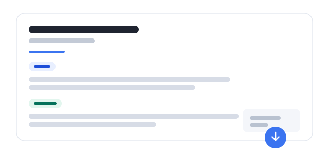

# DSH 会话分享图片 / Session share image

DeepSeek Harness（DSH）的会话视图插件：把选定的对话消息导出成一张 PNG 图片，方便直接分享。

A DeepSeek Harness plugin that exports selected messages of the current conversation as one shareable PNG.

## 功能

- 输入框上方的一排状态胶囊里新增 **分享为图片** 按钮
- 打开面板后按条勾选用户消息和助手消息，默认全选
- 右侧实时预览，浅色 / 深色两套配色可切换，点「放大」可全屏查看
- 支持滚轮缩放（20%–600%）、拖动平移
- **复制图片** 直接写入系统剪贴板；**下载 PNG** 保存到文件
- 导出图片包含：会话标题、消息条数与时间、每条消息的角色标签与时间、正文（标题 / 列表 / 引用 / 表格 / 代码块做轻量 Markdown 排版，表格按列对齐并自动折行，代码块带语言标签），页脚标注由 DeepSeek Harness 导出

## 安装

**本地目录**：设置 → 插件 → 添加插件，选择本目录。

**Git 源**：在插件管理里添加本仓库地址（带 `path:` 的 git 规格），或在插件市场索引里登记。

## 限制

- 只导出文字：图片、文件附件、思考过程、工具调用不在图片内（图片位置会显示 `[图片]` 占位）
- 只导出当前已加载的会话窗口；极长会话会被压到 30000px 高度以内，可能变窄
- 表格按 1080px 画布宽度自动分配列宽，列特别多时列会变窄、单元格折行变多
- 单个会话导出为一张图，不做分页
- 全部在浏览器内完成，消息不离开本机，也不发起额外模型请求

## 兼容性

在 DeepSeek Harness `2.0.23-next` 上开发验证。

## 开发

- `index.js`：Host 半侧，空实现
- `client.js`：客户端模块，注册 `conversation.composer.dock` 座位，全部逻辑（读取 `useChat` 快照、Markdown 解析、Canvas 绘制、剪贴板、下载）
- `locale/*.json`：插件展示元数据；界面文案在 `client.js` 的字典里走 Client locale 服务
- `docs/`：插件详情页的说明图

## License

MIT
